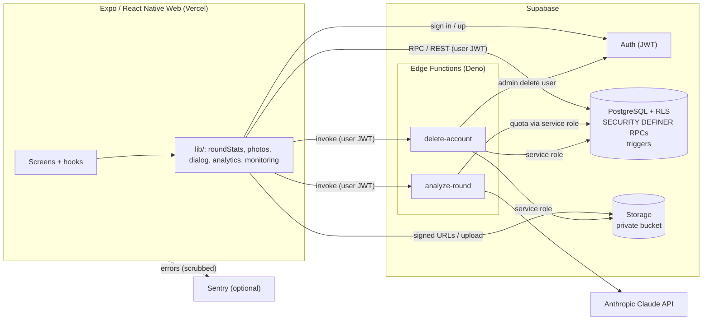

# Everyone 72

An AI golf coach: hole-by-hole scorecards, stats and handicap, Claude-written round analysis and practice plans, and a small social layer (friends, crews, buddy outings). Built by Ruiyi (Alan) Yang.

**[Live app](https://everyone72.vercel.app/) · [Public sample demo](https://everyone72.vercel.app/demo) · [Source code](https://github.com/RRYanng/everyone72)**

## Status

Last updated October 17, 2026.

- **Hosted app:** web frontend on Vercel, backend on Supabase (Auth, PostgreSQL, Storage, Edge Functions). Account creation, sign-in, saving and editing rounds, AI analysis from a signed-in account, round deletion and in-app account deletion have been exercised on the hosted project by the owner.
- **Public sample demo** (`/demo`) uses fixed example data. It does not call Claude or read user data, and is not evidence of live AI output or of improved golf performance.
- **Not verified:** long-term behaviour under real concurrent load, and any claim about active users. The roadmap is a historical plan, see [ROADMAP.md](ROADMAP.md).

## Features

**Rounds**
- Scorecard entry for 9 or 18 holes: strokes, putts and trouble tags per hole, with an autosaved draft that is isolated per user.
- 266 verified courses with per-hole pars; the course list lives in the database and is not client-writable.
- Round history, edit and delete. Editing recomputes totals on the server; deleting also removes the practice plan that round generated and restores the previous one.
- Stats are normalised so 9-hole and 18-hole rounds are never averaged together: averages and handicap are scaled to 18 holes (marked "≈" when estimated); best score is kept separate for 9 and 18 holes.

**AI coaching** (Claude through a server-side Edge Function)
- Per-round analysis and a weekly practice plan, plus a multi-round diagnosis report. If the AI is unavailable the app shows an honest error with a retry rather than substituting canned text.

**Practice and social**
- Practice check-ins with optional photos, a feed visible to accepted friends, and server-computed streaks and badges.
- Crews: invite codes, member list, and a handicap view that exposes only each member's handicap (and only after three rounds), never their scores.
- Buddy outings: city-scoped listings, join or request-to-join with organiser approval, comments with realtime updates.
- A coach-interest waitlist. A coach marketplace is **not** implemented.

**Account**
- In-app account deletion: type `DELETE`; the server transfers Crews that have other members, removes photos and the auth user, and everything else is deleted by foreign-key cascade.

**Quality**
- A global error boundary, opt-in Sentry error reporting with PII scrubbing, and basic first-party usage events.
- A Japandi-styled sign-in / sign-up that adapts from phone to desktop.

## Architecture



| Layer | Implementation |
| --- | --- |
| Frontend | React 18, React Native 0.74, Expo SDK 51, React Native Web, TypeScript, React Navigation |
| Backend | Supabase Auth, PostgreSQL, Storage, Edge Functions |
| AI | Claude (`claude-sonnet-5-5`, overridable with `ANTHROPIC_MODEL`) behind the `analyze-round` function |
| Hosting | Expo web export on Vercel |
| Monitoring | Sentry (only when `EXPO_PUBLIC_SENTRY_DSN` is set), plus an `app_events` table |

Code map: screens in [`src/screens`](src/screens), pure logic in [`src/lib`](src/lib) (kept free of UI so it can be unit-tested), schema and policies in [`supabase/migrations`](supabase/migrations), Edge Functions in [`supabase/functions`](supabase/functions).

## Security design

The client is untrusted. The anon key is public by design, so everything depends on the database refusing what a modified client could send. The rules, each covered by tests:

- **Row-level security on every table**, written so no policy recurses into itself (the original Crew and Buddies policies did, and were unusable).
- **Writes that need invariants go through `SECURITY DEFINER` functions**, not direct table access: `save_round`, `update_round`, `delete_round`, `create_crew`, `join_crew`, `join_coach_waitlist`, `track_event`. They validate input and derive totals themselves, so a client cannot submit a lying total. Direct client `DELETE` on rounds is closed; `rounds` allows a client `UPDATE` of only the `ai_feedback` column.
- **Server-authoritative data.** Courses and per-hole pars are seeded in the database; `save_round` rejects unknown courses and any par that disagrees with the database, so par cannot be edited to change relative-to-par or handicap. Streaks and badges are computed by triggers on `practice_logs`; `user_stats` is read-only for clients, so the leaderboard cannot be forged. The practice date is clamped to within one day of server time.
- **Privacy of what others can see.** Crew handicaps come from a function that returns only `(user_id, handicap)` for members of the same Crew. Public profiles are exposed through a view without email.
- **Photos are private.** The bucket is not public; photos are read through short-lived signed URLs that only the owner and accepted friends can obtain. Uploads are limited to 5 MB, image types only, and the caller's own folder.
- **Rate limits.** AI calls: a per-user daily quota enforced server-side. Crew invite codes: 8 wrong guesses per 15 minutes and 30 per day per user. Waitlist: three new entries per user per day. Usage events: a per-user daily cap.
- **Edge Functions validate the caller.** They ask Supabase Auth to verify the user's JWT (the public key alone is rejected), restrict CORS to the app's origins, bound prompt size, and never return upstream error text. `delete-account` also requires an explicit confirmation word and deletes the account last, so a partial failure can simply be retried.
- **Secrets.** `ANTHROPIC_API_KEY` and the service-role key exist only as Edge Function secrets. Nothing secret is in `EXPO_PUBLIC_*` variables or the client bundle.
- **Observability without leaking users.** Sentry reports carry an anonymous user id only: no email, IP, cookies, headers, console output or URL query strings.

Known limits: scores are self-reported, so the server can enforce consistency but cannot prove a round was played. The minimum password length also has to be set in the Supabase Auth settings; the client enforces 8 characters but only the server setting is binding. This is a hobby-scale project, not an audited system.

## Testing

```bash
npm test            # 69 unit tests: stats maths, prompt building, photos, streak, dialogs, layout, course-seed parity
npm run test:sql    # 206 assertions against a disposable Postgres built from the live schema + all migrations (needs Docker)
npm run test:edge   # Deno tests for both Edge Functions with an injected fake fetch; no network, no API cost (needs Docker)
npm run typecheck   # TypeScript for the app + Deno check for the Edge Function
```

`test:sql` replays the live schema snapshot and every migration, then runs the policy suite as different users (owner, friend, stranger, anonymous), including the abuse cases above. Browser-level flows, and the real Storage service (size and type limits, signed URLs, policy DDL), are exercised against a local Supabase stack as described in [`supabase/tests/e2e/README.md`](supabase/tests/e2e/README.md). Those end-to-end runs are manual, not part of CI.

## Running locally

```bash
git clone https://github.com/RRYanng/everyone72.git
cd everyone72
npm ci
cp .env.example .env
# set EXPO_PUBLIC_SUPABASE_URL and EXPO_PUBLIC_SUPABASE_ANON_KEY
npm run web
```

| Variable | Where | Purpose |
| --- | --- | --- |
| `EXPO_PUBLIC_SUPABASE_URL`, `EXPO_PUBLIC_SUPABASE_ANON_KEY` | client | Supabase project (the anon key is public by design) |
| `EXPO_PUBLIC_SENTRY_DSN` | client, optional | Enables error reporting; empty means off |
| `ANTHROPIC_API_KEY` | Edge Function secret | Claude API key. Never put it in `EXPO_PUBLIC_*` |
| `ANTHROPIC_MODEL`, `AI_DAILY_LIMIT`, `ALLOWED_ORIGINS` | Edge Function secrets, optional | Model, per-user daily AI quota (default 40), allowed web origins |

To provision your own backend, apply [`supabase/migrations`](supabase/migrations) in order (`supabase db push`), create the `practice-photos` bucket, and deploy the functions (`supabase functions deploy analyze-round delete-account`). Set the Auth minimum password length to 8 in the dashboard. Supplying the two public variables alone does not provision a database.

```bash
npm run build:web   # export the web frontend
```

Do not commit `.env`, service-role keys or AI credentials.

## Product decisions

The scorecard captures trouble tags alongside strokes and putts so diagnosis can use more context than totals. The report separates observations, evidence, possible causes and a practice plan; causal explanations are hypotheses. During earlier course-data cleanup 272 unverified courses were removed and 262 retained; that is a historical milestone, not a fresh verification.

## About the builder

Ruiyi (Alan) Yang — UC Irvine Cognitive Science, seeking FDE / Applied AI opportunities.

[Portfolio](https://ruiyiyang.vercel.app/) · [GitHub](https://github.com/RRYanng) · [LinkedIn](https://linkedin.com/in/ruiyiyang) · ruiyiyanng@gmail.com
